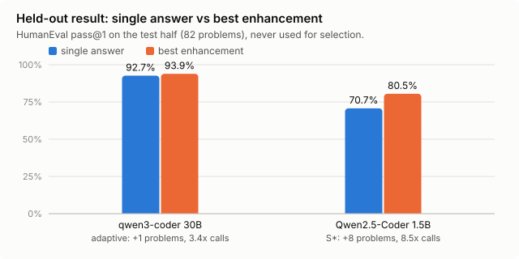
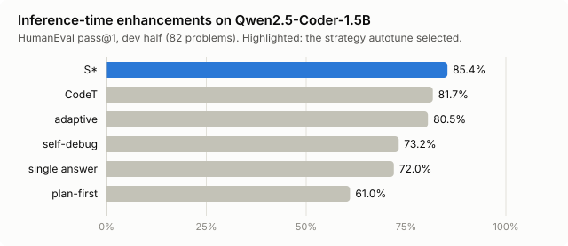
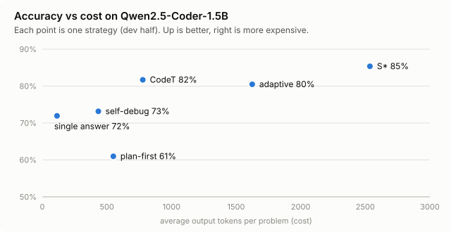
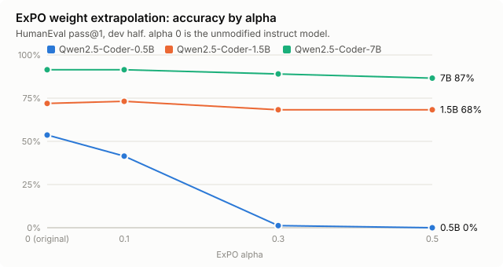

# Tvashtr

> In the Rig Veda, Tvashtr is the divine artisan who forged Indra's vajra and sharpened the tools of the
> gods. This project does the same for open models: it makes the model you already have sharper
> without retraining it.

**Documentation with architecture diagrams: https://dmdhrumilmistry.github.io/tvashtr**

Tvashtr makes a local Ollama coding model **measurably** better without fine-tuning. Nothing is
trained, and none of your code is used as data. It ships as:

- a Python package and CLI (`python -m tvashtr ...`),
- an **Ollama-compatible endpoint**, so Continue, Aider, Open WebUI or any Ollama/OpenAI client gets the
  enhanced model by picking a `tvashtr/<model>` name,
- a **Claude Code plugin** (skill + slash commands).

It improves models in two ways and measures both on held-out problems against an unmodified control:

1. **Post-training enhancements (PTEs):** extra inference-time compute around the same weights
   (parallel sampling, execution-feedback repair, test synthesis, selection by execution).
2. **Training-free weight updates:** ExPO extrapolation and task-vector arithmetic over checkpoints that
   already exist, producing a new GGUF.

## Results at a glance



| Model | Method | Held-out pass@1 | Change | Cost |
|---|---|---|---|---|
| Qwen2.5-Coder-1.5B-Instruct | **S\*** (test-time search) | **80.5%** (66/82) vs 70.7% | **+8 problems, +9.8 pts** | 8.5 calls, 24x tokens, ~36 s/problem |
| qwen3-coder:30b | adaptive | 93.9% (77/82) vs 92.7% | +1 problem (noise) | 3.4 calls, 6.5x tokens |
| Qwen2.5-Coder-7B-Instruct | ExPO weight update | 84.2% (69/82), original kept | 0 (no alpha beat the original) | none at run time |
| Qwen2.5-Coder-1.5B-Instruct | ExPO weight update | original kept | within noise | none at run time |
| Qwen2.5-Coder-0.5B-Instruct | ExPO weight update | original kept | hurts (-10 at alpha 0.1) | none at run time |

**In short:**
- **Small models gain a lot from test-time search.** S\* lifts the 1.5B model by about 10 points on
  problems it was never tuned on, enough to land close to the unmodified 7B (84.2%).
- **Strong models barely gain.** This matches recent work showing that self-repair barely moves
  Qwen3-Coder ([doi 10.3390/ai7090353](https://doi.org/10.3390/ai7090353)).
- **ExPO did not help any Qwen2.5-Coder size,** and it can destroy small models.
- **Merging a security fine-tune into a coder did not give one model that is good at both.**
  Grafting DeepHat-V1-7B onto Qwen2.5-Coder-7B-Instruct cost coding and kept none of DeepHat's
  CWE-mapping gain. For cyber + coding, route: `qwen3-coder:30b` for code, `gpt-oss:20b` for security
  ([details](#cyber--coding-in-one-model-weight-merging-no-training)).

Benchmark: HumanEval, 164 problems, split deterministically into a **dev** half (82, used to pick
strategies and alphas) and a **test** half (82, used only to report). Scoring uses the official hidden
tests. Hardware: i9-14900K, 32 GB RAM, RTX 3060 12 GB.

**Noise floor:** the same fp16 weights, registered twice and run at temperature 0, scored 44 vs 45,
41 vs 38 and 58 vs 60. GPU kernels are not bit-for-bit deterministic, so **treat differences of 3
problems or fewer (about 3.5 points) as noise.**

## Detailed results

### Inference-time enhancements on Qwen2.5-Coder-1.5B





| Strategy | Dev pass@1 | Test pass@1 | Model calls / problem | Output tokens / problem | Seconds / problem |
|---|---|---|---|---|---|
| single answer (`direct`) | 72.0% (59) | 70.7% (58) | 1.0 | 114 | 7 |
| plan-first (`plan`) | 61.0% (50) | | 2.0 | 550 | 6 |
| self-debug (`self_debug`) | 73.2% (60) | | 2.0 | 434 | 6 |
| adaptive (`adaptive`) | 80.5% (66) | | 5.8 | 1625 | 20 |
| CodeT (`codet`) | 81.7% (67) | | 6.0 | 778 | 11 |
| **S\* (`s_star`)** | **85.4% (70)** | **80.5% (66)** | 8.3 | 2536 | 30 |

What changed on the held-out half, S\* vs single answer
(full list: [`results/compare__...s_star__test.md`](results/compare__qc15_control__direct__test__vs__qc15_control__s_star__test.md)):

- **Improved 12, regressed 4.**
- **Crashes eliminated.** All 4 runtime errors (IndexError, ValueError, UnboundLocalError) are gone,
  because execution feedback catches them.
- **Wrong answers drop from 20 to 15.** The regressions are all wrong answers. Selection by execution
  agreement sometimes picks a plausible but wrong majority.

**Observations:**
- **Plan-first hurts small models (-9).** A 1.5B model's written plan is often wrong, and it then
  follows its own wrong plan faithfully.
- **Self-debug alone barely helps (+1).** Repairing one sample has nothing to choose between.
- **Diversity plus execution is what pays off.** CodeT (+8) and S\* (+11) sample several candidates
  and let execution choose.
- **CodeT is the cost-efficient pick.** It gets most of S\*'s gain at about a third of the tokens.

### Inference-time enhancements on qwen3-coder:30b

| Strategy | Test pass@1 | Calls | Output tokens | Seconds |
|---|---|---|---|---|
| single answer | 92.7% (76) | 1.0 | 186 | 11 |
| adaptive | 93.9% (77) | 3.4 | 1210 | 86 |

- **Result:** one problem improved and none regressed, which is within noise.
- **Why the failures persist:** all 5 remaining failures are wrong answers where the model's own tests
  share its misunderstanding, so verification never asks for more search. That is the main limit of
  self-generated tests.
- **Recommendation:** use `direct` for strong models.

### Training-free weight updates (ExPO)



`theta = theta_instruct + alpha * (theta_instruct - theta_base)` applied to the fp16 GGUFs Ollama serves.
Problems passed out of 82 on the dev half (alpha 0 is the unmodified instruct model):

| Model | alpha 0 | 0.1 | 0.3 | 0.5 | Held-out (kept model) |
|---|---|---|---|---|---|
| Qwen2.5-Coder-0.5B | **44** | 34 | 1 | 0 | 41 (original) |
| Qwen2.5-Coder-1.5B | 59 | 60 | 56 | 56 | 58 (original); alpha 0.3 scored 60, within noise |
| Qwen2.5-Coder-7B | **75** | 75 | 73 | 71 | 69 (original) |

**Why ExPO did not help here:**
- **What ExPO was designed for:** extrapolating a small preference-optimization step (SFT -> DPO).
- **What Qwen2.5-Coder's step is:** its base -> instruct delta bundles large-scale SFT and RL.
  Extrapolating past it overshoots, gently at 7B (-4 at alpha 0.5) and catastrophically at 0.5B
  (collapse at alpha 0.3).
- **When it might still help:** checkpoint pairs separated by a single, small alignment step.
- **The tool keeps the original when nothing beats it,** and alpha 0 is a valid result.

### Security models (held-out)

| Benchmark (test half) | Foundation-Sec-8B | qwen3:14b | gpt-oss:20b |
|---|---|---|---|
| CyberMetric-500 (250) | 81.6% | 90.4% | **90.8%** |
| CTIBench CTI-MCQ (150) | 54.7% | **68.7%** | **68.7%** |
| CTIBench CTI-RCM (100) | 59.0% (cot) | 55.0% | 60.0% direct, **63.0%** sc5 |
| Refusal rate | 0% | 0% | 0% |

### Cyber + coding in one model? Weight merging (no training)

Can the security skill of a fine-tune be moved into a strong coder by arithmetic on weights alone?
The donor is [DeepHat-V1-7B](https://huggingface.co/DeepHat/DeepHat-V1-7B), a security fine-tune of
Qwen2.5-Coder-7B. Its task vector `DeepHat - base` was grafted onto Qwen2.5-Coder-7B-Instruct:
`theta = instruct + beta * DARE(DeepHat - base)` (`python -m tvashtr graft`). Every variant was scored on
the dev halves of all four benchmarks, direct answering:

| Model (dev half) | HumanEval (82) | CyberMetric (250) | CTI-MCQ (150) | CTI-RCM (100) |
|---|---|---|---|---|
| Qwen2.5-Coder-7B-Instruct (control) | **91.5%** | 88.8% | 63.3% | 62.0% |
| DeepHat-V1-7B (donor alone) | 84.1% | 85.2% | **69.3%** | **83.0%** |
| graft beta 0.3 | 89.0% | **90.4%** | 63.3% | 64.0% |
| graft beta 0.7 | 86.6% | 90.0% | 66.7% | 62.0% |
| graft beta 1.0 | 85.4% | 90.0% | 64.0% | 61.0% |
| graft beta 0.5, DARE 0.9 | 85.4% | 90.0% | 63.3% | 62.0% |
| graft beta 1.0, DARE 0.9 | 86.6% | 89.6% | 64.0% | 64.0% |

**Conclusion: no merge is worth shipping.**
- **No variant keeps coding and gains real security skill.** Every graft costs 2-6 coding problems.
  The +1 to +2 points on CyberMetric are within noise (3-4 questions of 250).
- **DeepHat's large CWE-mapping gain (+21) does not transfer at any strength.** A per-question diff
  shows why. In 9 of its 22 wins the instruct model answered the parent class CWE-119, and DeepHat
  answered the specific child NVD assigns (CWE-787, CWE-121, CWE-120); likewise CWE-203 instead of
  CWE-200. That is a labelling convention learned from NVD-style data, which may include these very
  CVEs, not transferable security knowledge. The instruct model's own answer style wins inside a merge.
- **DARE did not help.** Dropping 90% of the delta also dropped the skill, and coding still fell.
- **The task vectors are nearly orthogonal** (cosine about 0.05 between `DeepHat - base` and
  `instruct - base`), so this is not interference that a smarter merge rule would resolve.
- **The skill can be reached without weights:** the MITRE retrieval strategies (`rag`, `rag_hyde`) and
  an explicit "most specific CWE that NVD uses" instruction target the same gap.

### Which model to use for cyber + coding

No single local model measured here is best at both, so route by task. `tvashtr serve` with
`model=tvashtr/auto` classifies each request and sends it to the right model and strategy:

| Task | Model | Held-out score | Why |
|---|---|---|---|
| **Coding** | `qwen3-coder:30b` + `adaptive` | HumanEval **93.9%** | best coder measured; MoE with ~3B active parameters, runs on a 12 GB GPU + 32 GB RAM |
| **Security knowledge, threat intel** | `gpt-oss:20b` | CyberMetric **90.8%**, CTI-MCQ **68.7%** | best or tied best; 0% refusals |
| **CVE -> CWE mapping** | `gpt-oss:20b` + `sc5` (or DeepHat-V1-7B if NVD-style labels matter) | CTI-RCM **63.0%** | DeepHat scored 83% on dev but with possible training overlap; confirm on your own CVEs |
| **One model only** | `qwen2.5-coder:7b-instruct` (unmodified) | HumanEval 84.2% held-out; CyberMetric 88.8%, CTI-MCQ 63.3%, CTI-RCM 62.0% dev | close to qwen3:14b on security, strong on code, fits 12 GB at q8 or lower |

Only one 20-30B model fits in 12 GB of VRAM at a time, so the first request after switching task
types waits a few seconds while Ollama swaps models.

### Which model to use where

| Device | Recommendation |
|---|---|
| Phone (Android: PocketPal, ChatterUI, Ollama in Termux) | stock `qwen2.5-coder:1.5b` at q4_K_M (~1 GB, ~71%). On weaker phones, `qwen2.5-coder:0.5b` (~400 MB, ~50-54%). Test-time search is too slow on a phone. |
| PC with 8-12 GB GPU | `tvashtr/qwen2.5-coder:1.5b` with S\* for about 7B-level accuracy at 1.5B memory, or plain 7B |
| PC with 24 GB+ RAM | `qwen3-coder:30b` for code, `gpt-oss:20b` for security, routed by `tvashtr/auto` |

## Install

```bash
git clone https://github.com/dmdhrumilmistry/tvashtr && cd tvashtr
uv venv .venv && uv pip install --python .venv -e .     # or: python -m venv .venv && pip install -e .
ollama pull qwen2.5-coder:1.5b                            # or any coding model
```

Requirements: Python 3.10+, numpy and requests (installed automatically), and Ollama running locally.
No GPU is needed for weight updates. A GPU speeds up benchmarking.

### As a Claude Code plugin

```
/plugin marketplace add dmdhrumilmistry/tvashtr
/plugin install tvashtr@tvashtr
```

This adds the `tvashtr` skill and these commands:

| Command | What it does |
|---|---|
| `/tvashtr:bench <model> [strategy]` | benchmark a model on held-out HumanEval |
| `/tvashtr:autotune <model>` | pick the best strategy on dev, confirm on test, save the profile |
| `/tvashtr:serve` | start the enhanced Ollama-compatible endpoint |
| `/tvashtr:expo <family>` | run a controlled ExPO weight-update experiment |

## Usage

### 1. Measure a baseline and an enhancement

```bash
python -m tvashtr bench --model qwen2.5-coder:1.5b --strategy direct --part test
python -m tvashtr bench --model qwen2.5-coder:1.5b --strategy s_star --part test
python -m tvashtr compare results/qwen2.5-coder_1.5b__direct__test.jsonl \
                          results/qwen2.5-coder_1.5b__s_star__test.jsonl     # what improved / regressed
```

- **Strategies:** `direct`, `plan`, `self_debug`, `codet`, `s_star`, `adaptive`.
- **Parameters:** tune with `--params '{"n": 6, "rounds": 3}'`. `n` is the number of parallel samples
  and `rounds` the number of repair rounds.
- **Resuming:** runs resume where they stopped. Rows that failed on infrastructure errors (Ollama
  5xx) are retried automatically.

### 2. Let Tvashtr choose per model

```bash
python -m tvashtr autotune --model qwen2.5-coder:1.5b   # writes profiles/qwen2.5-coder_1.5b.json
```

Autotune scores every strategy on the dev half, picks the best one, preferring the cheaper strategy
when scores are within one problem, and reports it against `direct` on the test half.

### 3. Serve the enhanced model to your tools

```bash
python -m tvashtr serve --port 11435
```

Point any Ollama client at `http://127.0.0.1:11435`. OpenAI-compatible clients use
`http://127.0.0.1:11435/v1`. Then choose a `tvashtr/<model>` name:

- **Enhanced:** self-contained Python code-writing requests run through the model's profile strategy.
- **Passed through to Ollama unchanged:** tool and agent calls, FIM autocomplete, explanations,
  non-Python requests, and plain model names. Nothing breaks.

```yaml
# Continue (~/.continue/config.yaml)
models:
  - name: qwen2.5-coder 1.5B + S* (tvashtr)
    provider: ollama
    apiBase: http://127.0.0.1:11435
    model: tvashtr/qwen2.5-coder:1.5b
    roles: [chat, edit]
```

```bash
# Aider
OLLAMA_API_BASE=http://127.0.0.1:11435 aider --model ollama_chat/tvashtr/qwen2.5-coder:1.5b
```

### 4. Try a training-free weight update

```bash
ollama pull qwen2.5-coder:7b-base-fp16
ollama pull qwen2.5-coder:7b-instruct-fp16
python -m tvashtr expo-sweep --base qwen2.5-coder:7b-base-fp16 --instruct qwen2.5-coder:7b-instruct-fp16 \
    --prefix qc7 --alphas 0.1,0.3,0.5 --workdir models
```

The sweep registers an equally prepared **control**, scores each alpha on dev, and confirms the winner
on test. The report goes to `results/expo-sweep__qc7.json`.

| Building block | Command |
|---|---|
| ExPO on GGUFs (Ollama tags or paths) | `expo-gguf --base ... --instruct ... --alpha 0.3 --out x.gguf --name my:model` |
| ExPO on safetensors | `expo --base DIR --instruct DIR --alpha 0.3 --out DIR` |
| Add same-family fine-tunes as task vectors | `--donor <tag-or-gguf>:<beta>` (repeatable) |
| Check at the shipping quantization | `deploy-check --alpha 0.3 --quantize q4_K_M --export DIR` |

All of them stream tensors in 64 MB chunks through numpy. No torch and no GPU are needed, and a 7B
merge uses a few GB of RAM.

### 5. Re-score after a harness change, and regenerate charts

```bash
python -m tvashtr rescore results/*.jsonl      # re-extract code and re-run hidden tests, no model calls
python scripts/make_charts.py                  # rebuild docs/charts/*.svg from results/
```

## How the metrics work

| Metric | Meaning |
|---|---|
| **pass@1** | share of problems whose single returned solution passes all official hidden tests |
| **dev / test** | deterministic halves of HumanEval (even and odd index). Choices are made on dev only, and test is reported |
| **control** | the unmodified model, imported exactly like each variant, so only the intervention differs |
| **avg calls** | model requests per problem, including test synthesis, repair and judging |
| **avg output tokens** | generated tokens per problem, the main cost driver |
| **improved / regressed** | per-problem flips between two runs (`compare`) |
| **failure type** | `wrong_answer` (AssertionError), `runtime:<Error>`, `syntax_error`, `timeout`, `no_code` |

Strategies may use only what a user would provide: the problem statement and the examples in its
docstring (turned into "public tests"). Hidden tests are used only for the final score.

## How the strategies work

| Strategy | Idea | Paper |
|---|---|---|
| `plan` | write a plan, then code to it | Self-planning, [arXiv 2303.06689](https://arxiv.org/abs/2303.06689) |
| `self_debug` | run public tests, feed the failure back, repair, and keep a repair only if it is not worse | Self-Debugging [arXiv 2304.05128](https://arxiv.org/abs/2304.05128), Reflexion [arXiv 2303.11366](https://arxiv.org/abs/2303.11366) |
| `codet` | N samples x M model-written tests; pick the cluster with the best (samples x tests passed) agreement | CodeT, [arXiv 2207.10397](https://arxiv.org/abs/2207.10397) |
| `s_star` | N parallel samples, each debugged on public tests; finalists are clustered by their outputs on synthesized "distinguishing inputs", and the LLM adjudicates ties | S\*, [arXiv 2502.14382](https://arxiv.org/abs/2502.14382) |
| `adaptive` | greedy answer plus cheap verification; escalate to S\* only if verification fails | Tvashtr |
| ExPO | extrapolate along the instruct - base direction | [arXiv 2404.16792](https://arxiv.org/abs/2404.16792) |
| task arithmetic | add `beta * (donor - base)` | [arXiv 2212.04089](https://arxiv.org/abs/2212.04089) |

Background: Davidson et al., *AI capabilities can be significantly improved without expensive
retraining* ([arXiv 2312.07413](https://arxiv.org/abs/2312.07413)), find that most post-training
enhancements are worth more than 5x, and many more than 20x, the training compute needed to match
them. The 1.5B result here, S\* reaching near-7B accuracy, is an instance of that.

## Lessons learned (read before trusting a number)

1. **An implausibly large gain is a harness bug until proven otherwise.** Qwen2.5-Coder-1.5B emits CRLF
   line endings, which defeated the code-fence regex. Its control appeared to score 15%, and ExPO
   appeared to gain 50 points. The fix is a normalising extractor; old runs were corrected with
   `rescore`.
2. **Infrastructure errors are not model failures.** With `OLLAMA_NUM_PARALLEL=1`, parallel S\* samples
   overflowed Ollama's queue and returned HTTP 500. The client now retries with backoff, and resumed
   benchmarks re-run errored rows. This moved S\*'s held-out score from 75.6% to 80.5%.
3. **Never measure one quantization under another's name.** Recent Ollama builds cannot quantize GGUF
   imports here and fell back to fp16. `deploy-check` now refuses instead of silently mislabelling.
4. **Self-generated tests share the model's blind spots.** Most remaining failures pass the model's
   own tests.
5. **Measure the noise floor.** At temperature 0 the same weights still varied by up to 3 problems.
6. **Diff the wins before crediting a fine-tune.** DeepHat's +21 on CWE mapping was mostly choosing the
   specific CWE that NVD assigns (CWE-787) over its parent (CWE-119), a labelling habit rather than
   deeper knowledge, which is why it did not survive merging.

## Publishing a model so others can use it

- **ollama.com:**
  1. Create an account.
  2. Add `~/.ollama/id_ed25519.pub` under Settings -> Ollama keys.
  3. Run `ollama cp my:model <user>/<name>:<tag>`, then `ollama push <user>/<name>:<tag>`.
- **Hugging Face:** upload the GGUF with `hf upload <user>/<repo> model.gguf`. Users then run
  `ollama run hf.co/<user>/<repo>`.
- **What can be published:** inference-time strategies are not weights, so others get those by
  installing Tvashtr and running `serve`. Only publish weight variants that beat their control on the
  held-out half.

## Safety notes

- **Sandbox:** generated code runs in a temporary directory with a timeout, an isolated interpreter
  and a scrubbed environment. That is process isolation, not a security boundary. Set
  `TVASHTR_SANDBOX=docker` to run each program in a disposable container with no network.
- **Benchmark data:** HumanEval is downloaded from the official OpenAI repository on first use.
- **Memory:** large fp16 checkpoints are memory-hungry. A dedicated Ollama instance with
  `OLLAMA_MAX_LOADED_MODELS=1 OLLAMA_NUM_PARALLEL=1` and a model store on a big drive
  (`OLLAMA_MODELS=D:\models\ollama`) keeps experiments stable. See `scripts/run-experiments.ps1`.

## Layout

```
tvashtr/strategies.py   PTEs: direct, plan, self_debug, codet, s_star, adaptive
tvashtr/sandbox.py      execution, test running, output signatures, code extraction
tvashtr/bench.py        HumanEval harness, dev/test split, docstring-example extraction, resume
tvashtr/autotune.py     per-model strategy selection -> profiles/
tvashtr/server.py       Ollama + OpenAI compatible enhanced endpoint
tvashtr/weights.py      ExPO / task arithmetic on safetensors and GGUF
tvashtr/sweep.py        controlled ExPO sweep and deploy-check
tvashtr/compare.py      per-problem improved/regressed diff with failure types
tvashtr/rescore.py      re-score stored outputs after a harness fix
scripts/                experiment runners and chart generator
results/                raw per-problem JSONL for every run, summaries and diffs
docs/charts/            README charts (generated)
skills/ commands/ .claude-plugin/   Claude Code plugin
```

## License

Apache-2.0. Model weights you produce inherit their base models' licences (Qwen2.5-Coder 0.5B / 1.5B /
7B: Apache-2.0).
