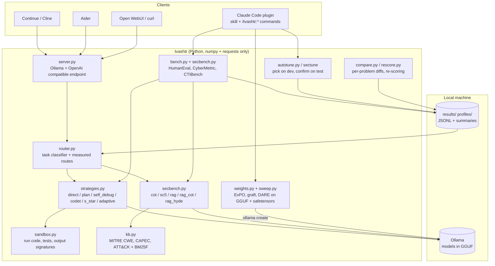
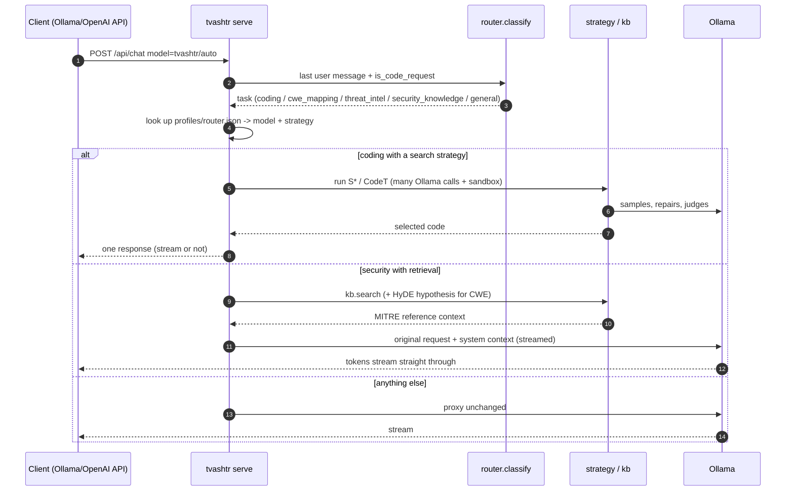
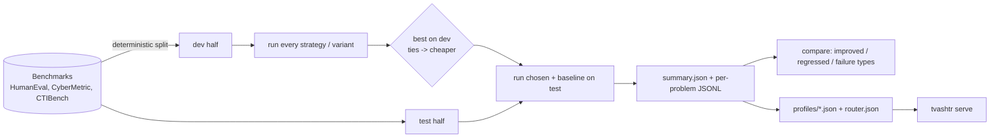

# Architecture
{: .no_toc }

1. TOC
{:toc}

## Components

| Module | Responsibility |
|---|---|
| `llm.py` | Minimal Ollama client: token accounting, retries with backoff on 5xx, `think` control for reasoning models |
| `sandbox.py` | Runs model-written Python in a temp dir with a timeout. Extracts code (CRLF-safe), runs assert lists, and computes output signatures for S\* clustering |
| `strategies.py` | The inference-time enhancements for code |
| `bench.py` | HumanEval loader, deterministic dev/test split, docstring examples as public tests, resumable runs |
| `secbench.py` | Security benchmarks plus MCQ and CWE strategies (reasoning, self-consistency, retrieval) |
| `kb.py` | Downloads and parses the MITRE catalogues, BM25F index, CWE view expansion |
| `router.py` | Builds `profiles/router.json` from dev scores and classifies live requests into tasks |
| `server.py` | HTTP server speaking the Ollama and OpenAI APIs; passthrough for everything it does not enhance |
| `weights.py` | Streaming safetensors and GGUF readers/writers, ExPO, cross-format task arithmetic, DARE |
| `sweep.py` | Controlled weight experiments: control vs variants, dev selection, test confirmation |
| `compare.py`, `rescore.py` | Improved / regressed problem lists with failure types; re-score after harness fixes |

## Request flow through the server

Design rules:
- **Never break the client.** Tool calls, FIM autocomplete, images, non-Python code and unknown
  routes are proxied byte-for-byte. If an enhancement throws, the request falls back to the plain model.
- **Streaming is preserved** for retrieval routes, because the context is injected and the request
  is forwarded. Search strategies have to finish before they can answer, so they return one chunk.

## Data flow of an experiment

Every run writes one JSON line per problem (prediction, pass/fail, calls, tokens, seconds, trace), so
runs can resume, be re-scored after a harness fix, and be diffed problem by problem.

## Where things are stored

| Path | Content |
|---|---|
| `data/` | downloaded benchmarks and MITRE catalogues (not committed; licences vary) |
| `results/*.jsonl` | per-problem rows for every run |
| `results/*.summary.json` | aggregate metrics per run |
| `results/compare__*.md` | per-problem diffs |
| `profiles/*.json` | chosen strategy per model; `router.json` for `tvashtr/auto` |
| `docs/charts/*.svg` | charts regenerated by `scripts/make_charts.py` |
