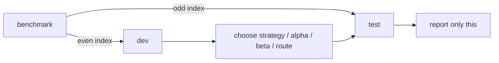

# Evaluation method
{: .no_toc }

1. TOC
{:toc}

## Benchmarks

| Benchmark | Measures | Size used | Scoring |
|---|---|---|---|
| HumanEval | Python coding | 164, split 82 / 82 | official hidden tests, pass@1 |
| CyberMetric-500 | broad security knowledge | 500, split 250 / 250 | 4-option MCQ, exact match |
| CTIBench CTI-MCQ | threat intel (ATT&CK, CWE, CAPEC) | 300 sampled, 150 / 150 | 4-option MCQ, exact match |
| CTIBench CTI-RCM | CVE description -> CWE | 200 sampled, 100 / 100 | exact CWE ID |

Datasets download on first use and are never committed or redistributed (CTIBench is CC-BY-NC-SA).

## Discipline

- **Dev chooses, test reports.** No choice ever looks at test scores.
- **Controls:** weight variants are compared with the unmodified model, prepared and quantized
  identically.
- **Ties go to the cheaper option.** A difference of one question is treated as a tie. The tie band
  includes an epsilon, because summaries are rounded to 4 decimals (38/60 -> 0.6333).
- **Noise floor:** the same weights at temperature 0 varied by up to 3 problems out of 82. Smaller
  deltas are not claimed as gains.
- **Infrastructure errors are not failures.** Rows that died on Ollama 5xx are retried when a run
  resumes.

## Metrics

| Metric | Meaning |
|---|---|
| pass@1 / accuracy | share of single returned answers that are correct |
| unparsed | answers with no extractable letter or CWE |
| refusal rate | unparsed answers containing refusal language: the over-refusal signal |
| avg calls / output tokens / seconds | cost per question |
| improved / regressed | per-problem flips between two runs (`compare`) |
| failure type | wrong_answer, runtime:<Error>, syntax_error, timeout, no_code |

## Lessons learned

1. **An implausibly large gain is a harness bug until proven otherwise.** CRLF line endings defeated
   code extraction, which made a control score 15% and ExPO look like +50 points. Fixed, and every run
   was re-scored.
2. **Answer extraction can masquerade as model quality.** Reasoning looked 10 points worse until
   two-stage extraction handled answers that paraphrase an option instead of naming its letter.
3. **Infrastructure noise:** HTTP 500s from a full Ollama queue were scored as failures until retries
   were added, which understated S\* by about 5 points.
4. **Never measure one quantization under another's name.** A silent fp16 fallback is now a hard error.
5. **Retrieval needs its own metric.** Recall@k exposed a tokenizer bug and the missing NVD view
   expansion before any model was involved.
