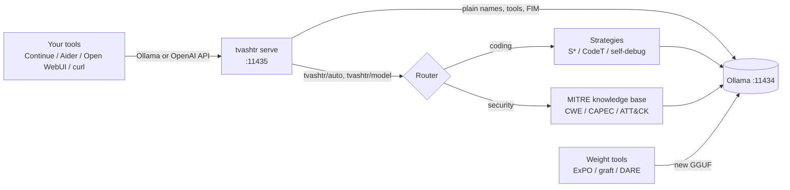

# Tvashtr
{: .fs-9 }

Make the local model you already have measurably better at **coding and cyber security**, without
training it.
{: .fs-6 .fw-300 }

[Get started](usage.html){: .btn .btn-primary .mr-2 } [Architecture](architecture.html){: .btn .mr-2 }
[GitHub](https://github.com/dmdhrumilmistry/tvashtr){: .btn }

> In the Rig Veda, Tvashtr is the divine artisan who forged Indra's vajra and sharpened the tools of the
> gods. This project does the same for open models.

## What it does

Tvashtr wraps any Ollama model with three kinds of improvement and **proves each one on held-out
problems** before using it:

| Layer | What changes | Example | Where it lives |
|---|---|---|---|
| Inference-time enhancements | how answers are produced (sampling, testing, repair, voting) | S\* search lifts a 1.5B coder from 70.7% to 80.5% | [Strategies](strategies.html) |
| Knowledge retrieval | what the model sees (MITRE CWE, CAPEC, ATT&CK) | CWE retriever R@1 28% -> 53% using NVD's view | [Security](security.html) |
| Training-free weight updates | the weights themselves (ExPO, task arithmetic, DARE) | graft a security fine-tune's skill onto a coding model | [Weights](weights.html) |

Everything is exposed through an **Ollama-compatible server**, so Continue, Aider, Open WebUI, Cline or
any OpenAI client gets the improvement by choosing a model name such as `tvashtr/auto`.

## Headline results

| Model | Method | Held-out result |
|---|---|---|
| Qwen2.5-Coder-1.5B | S\* test-time search | **70.7% -> 80.5%** HumanEval (+8 problems) |
| qwen3-coder:30b | adaptive search | 92.7% -> 93.9% (+1, noise) |
| Foundation-Sec-8B | reason-then-answer | CVE->CWE **51% -> 59%** |
| qwen3:14b / gpt-oss:20b | direct | CyberMetric ~90.5%, 0% refusals |
| Qwen2.5-Coder 0.5B / 1.5B / 7B | ExPO weights | never beat the original |

Full tables, charts and per-problem diffs: [Results](results.html).

## Pages

- [Architecture](architecture.html): components, request flow, data flow
- [Strategies](strategies.html): how each inference-time enhancement works
- [Security](security.html): knowledge base, retrieval, routing for cyber tasks
- [Weights](weights.html): ExPO, task arithmetic, DARE, the GGUF pipeline
- [Evaluation](evaluation.html): benchmarks, dev/test discipline, metrics, lessons learned
- [Usage](usage.html): install, CLI, server, Claude Code plugin, publishing
- [Results](results.html): every number with its source file
