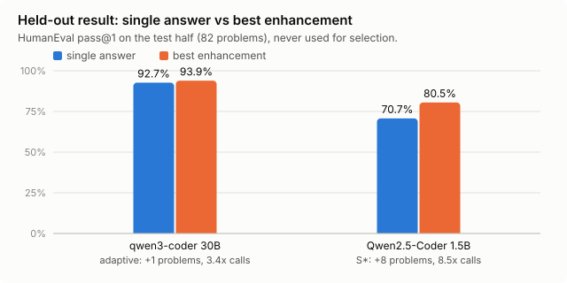
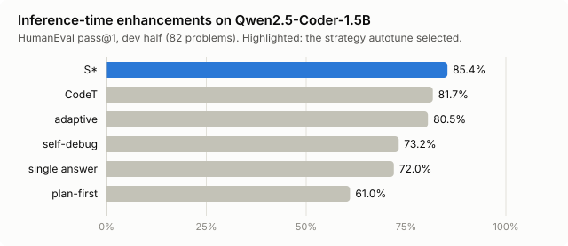
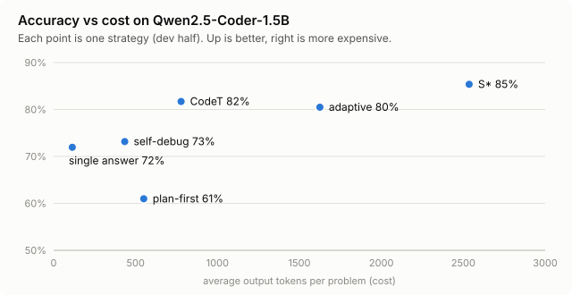
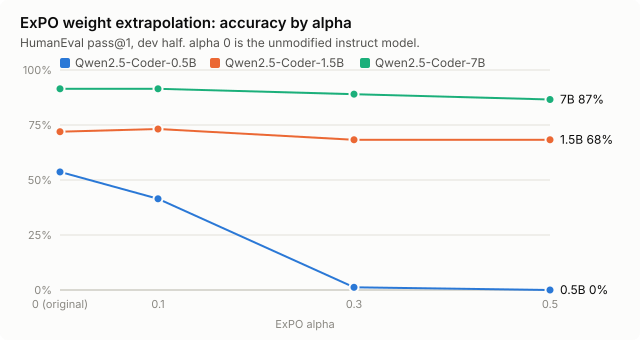

# Results
{: .no_toc }

All numbers come from `results/` in the repository: one JSON line per problem plus summaries.
"Held-out" means the test half, which is never used for selection.

1. TOC
{:toc}

## Coding

| Model | Strategy | Held-out pass@1 | Calls | Notes |
|---|---|---|---|---|
| Qwen2.5-Coder-1.5B | direct | 70.7% | 1 | baseline |
| Qwen2.5-Coder-1.5B | **S\*** | **80.5%** | 8.5 | 12 fixed, 4 broken, crashes eliminated |
| qwen3-coder:30b | direct | 92.7% | 1 | |
| qwen3-coder:30b | adaptive | 93.9% | 3.4 | +1, within noise |
| Qwen2.5-Coder-7B | direct | 84.2% | 1 | ExPO control |

## Weights

| Model | alpha 0 | 0.1 | 0.3 | 0.5 (dev, of 82) |
|---|---|---|---|---|
| Qwen2.5-Coder-0.5B | **44** | 34 | 1 | 0 |
| Qwen2.5-Coder-1.5B | 59 | 60 | 56 | 56 |
| Qwen2.5-Coder-7B | **75** | 75 | 73 | 71 |

## Security

| Benchmark (held-out) | Foundation-Sec-8B | qwen3:14b | gpt-oss:20b |
|---|---|---|---|
| CyberMetric-500 (250) | 81.6% | 90.4% | **90.8%** |
| CTI-MCQ (150) | 54.7% | **68.7%** | **68.7%** |
| CTI-RCM (100) | **59.0%** (cot; 51.0% direct) | 55.0% | in progress |
| Refusal rate | 0% | 0% | 0% |

Retrieval and routing results land in `results/scorecard.md` when the unified evaluation finishes.
