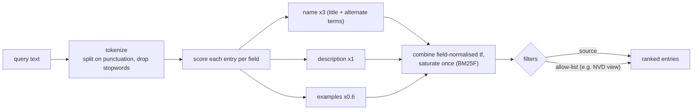
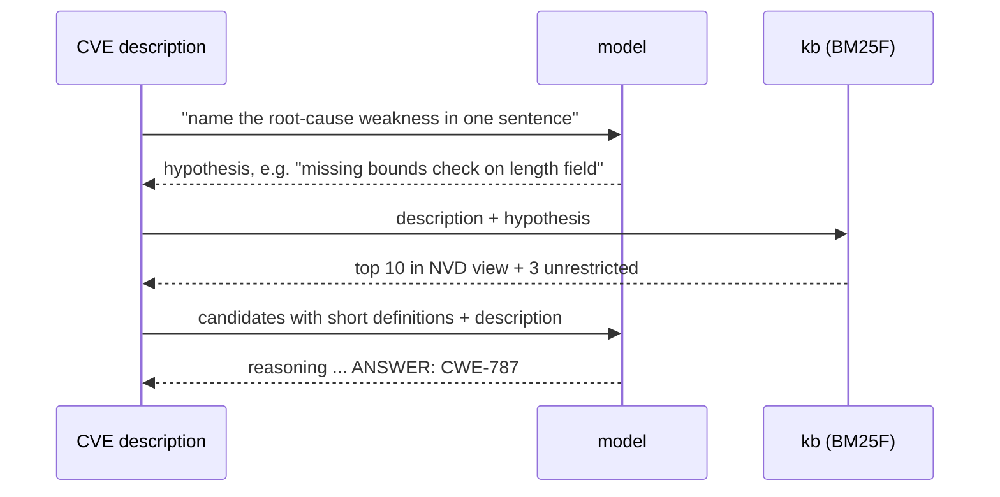
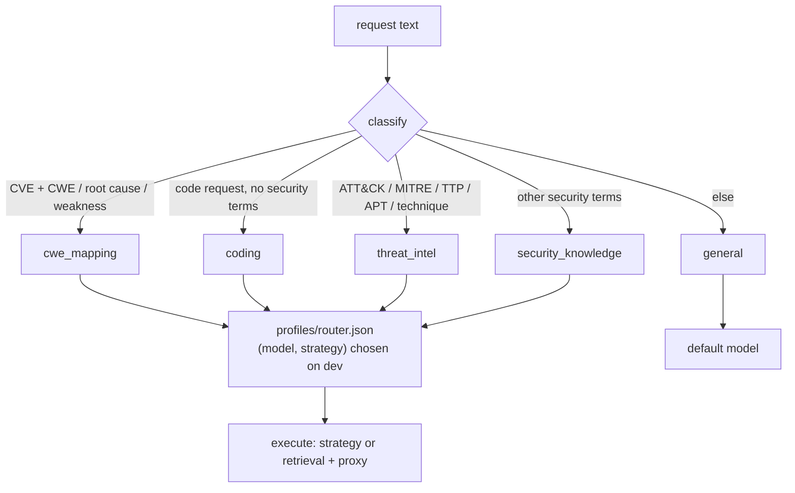

# Cyber security without retraining
{: .no_toc }

1. TOC
{:toc}

## Knowledge base

`kb.py` downloads three public MITRE catalogues on first use and builds a pure-Python index (about
3,300 entries):

| Source | Entries | What each entry contains |
|---|---|---|
| CWE | 956 weaknesses and categories | name, description, alternate terms, **observed examples** (real CVE descriptions MITRE mapped to the CWE) |
| CAPEC | 559 attack patterns | description, mitigations, related CWEs |
| ATT&CK Enterprise | 1,785 objects | techniques with tactics, platforms, **mitigations** and **groups that use them**; mitigations; groups; software |

### Retrieval: BM25F

Two bugs were found and fixed with measurement:
- **Tokenizer:** splitting on punctuation is needed because `use-after-free` must match
  "Use After Free".
- **Field weighting:** pooling all fields let long example text drown out precise names. Per-field
  normalisation fixed it.

### NVD's view: the biggest single gain

NVD assigns CWEs from the CWE-1003 view (130 entries). That view is a graph: children attach through
view-scoped `ChildOf` relationships, so they must be expanded. Restricting candidates to it:

| Retriever (CTI-RCM dev, 100 CVEs) | R@1 | R@5 | R@10 | R@20 |
|---|---|---|---|---|
| all CWEs | 28% | 57% | 68% | 78% |
| **NVD view** | **53%** | **77%** | **81%** | **84%** |

The retriever alone puts the right CWE first 53% of the time, as often as the models manage from memory.

### Leakage checks

- **No benchmark data is indexed.** Only the public catalogues are.
- **No answer lookups:** none of the benchmark's CVE IDs appear among MITRE's observed examples.
- **CTI-MCQ is closer to an open-book exam.** Its questions were generated from ATT&CK (63%), CWE
  (22%) and CAPEC (9%) pages, so retrieval there is reported separately from closed-book scores.

## CWE mapping pipeline (`rag_hyde`)

## Measured security baselines (held-out)

| Benchmark | Foundation-Sec-8B | qwen3:14b | gpt-oss:20b |
|---|---|---|---|
| CyberMetric-500 (250) | 81.6% | 90.4% | **90.8%** |
| CTIBench CTI-MCQ (150) | 54.7% | **68.7%** | **68.7%** |
| CTIBench CTI-RCM (100) | 59.0% (cot) | 55.0% | 60.0% direct, **63.0%** sc5 |
| Refusals | 0% | 0% | 0% |

- **No model refused a legitimate security question,** so over-refusal is not the bottleneck.
- **Knowledge questions:** reasoning and voting tie with direct for every model.
- **CWE mapping:** reasoning helped the security-tuned model (+8 points).

## Routing coding and security together

`python -m tvashtr router` builds `profiles/router.json` and `results/scorecard.md` from the measured
runs, selecting on dev only. The server then serves the result as `tvashtr/auto`.

Plan and integrity rules: [security plan](security-plan.html).
