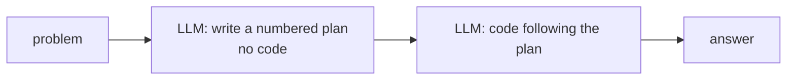
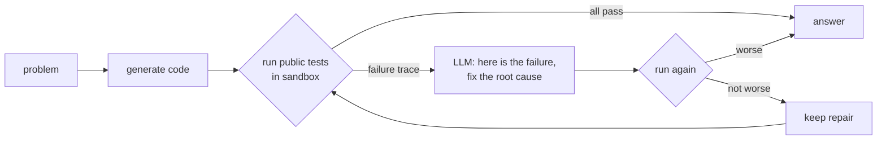
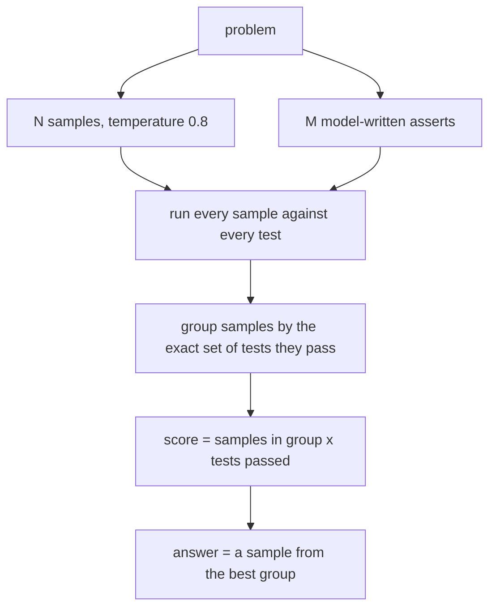
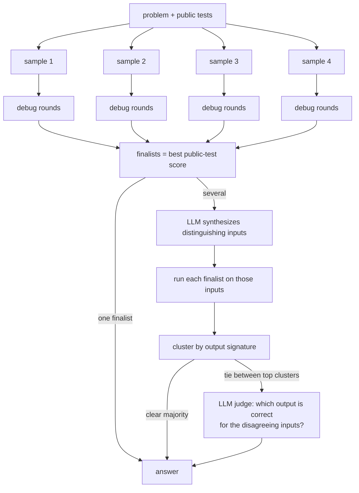
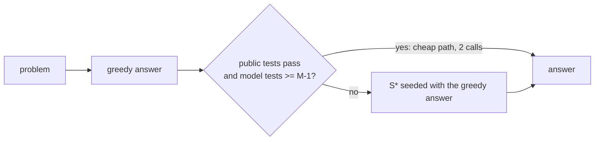

# Inference-time enhancements
{: .no_toc }

These change *how* an answer is produced. The weights stay the same. All of them use only what a real
user would provide: the problem statement and the examples written in it.

1. TOC
{:toc}

## direct

One greedy answer. This is the baseline every other strategy has to beat.

## plan (self-planning)

**Measured:** -9 problems on Qwen2.5-Coder-1.5B. A small model's plan is often wrong, and it then
follows its own wrong plan faithfully.

## self_debug (execution feedback)

A repair is accepted only if it passes at least as many tests as before, so it can never regress.
**Measured:** +1 on 1.5B. With a single sample there is nothing to choose between.

## codet (dual execution agreement)

Model-written tests are individually unreliable. CodeT's insight is that agreement between independent
samples and independent tests is reliable. **Measured:** +8 on 1.5B dev at about 6 calls.

## s_star (S\*: parallel + sequential scaling)

**Measured:** 1.5B held-out **70.7% -> 80.5%** (12 fixed, 4 broken, all crashes eliminated), at about
8.5 calls and 24x the tokens. This is the strongest coding gain in the project.

## adaptive (Tvashtr's escalation)

Spends search compute only where verification fails. It is weaker when the model's own tests share
its misunderstanding: then the wrong answer passes verification and never escalates.

## Security strategies (multiple choice and CWE mapping)

| Strategy | How it works |
|---|---|
| `direct` | answer only (letter or CWE ID) |
| `cot` | short reasoning, final `ANSWER:` line. If no parseable answer, one follow-up asks for just the answer (two-stage extraction, Kojima et al. 2022) |
| `sc5` | five sampled `cot` answers, majority vote (self-consistency, Wang et al. 2023) |
| `rag` | retrieve MITRE entries, then answer directly |
| `rag_cot` | retrieve, then reason |
| `rag_hyde` | the model first names the weakness in its own words; retrieval uses description + hypothesis |

How these retrieve: [Security](security.html).

## How a strategy is chosen

`autotune` / `sectune` run every strategy on the **dev** half, take the best one (a one-question tie
goes to the cheaper strategy), then run it and `direct` on the **test** half. Only the test number is
reported. The choice is saved to `profiles/`, and the server uses it.
