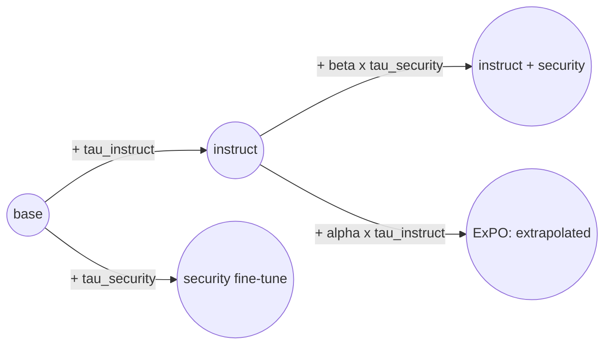
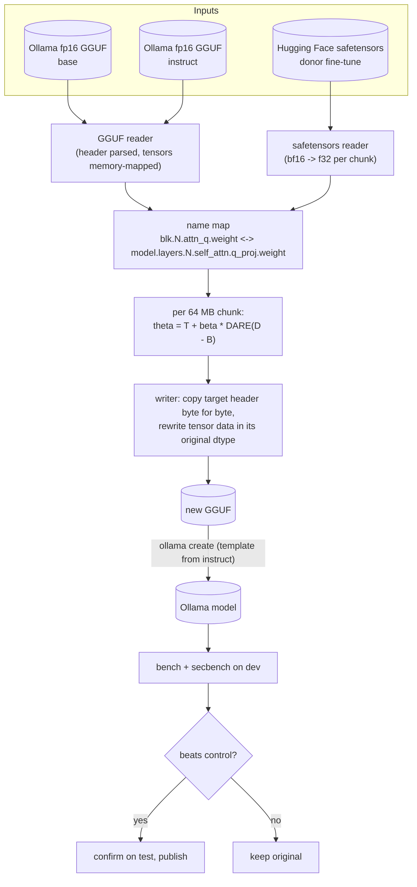

# Training-free weight updates
{: .no_toc }

These produce a **new model file**. No gradients, no GPU: tensors stream through numpy in 64 MB
chunks, so a 7B merge needs a few GB of RAM. The result is a normal GGUF that Ollama, llama.cpp,
LM Studio and phone apps can load.

1. TOC
{:toc}

## The idea: task vectors

A fine-tune is a base model plus a difference. That difference, the **task vector**, can be scaled,
added to another model, or extrapolated.



| Method | Formula | Paper |
|---|---|---|
| ExPO | `theta = I + alpha * (I - B)` | Zheng et al. 2024, arXiv 2404.16792 |
| Task arithmetic | `theta = T + beta * (D - B)` | Ilharco et al. 2023, arXiv 2212.04089 |
| DARE | drop a fraction `p` of delta entries at random, rescale the rest by `1/(1-p)` | Yu et al. 2024, arXiv 2311.03099 |

## Pipeline



Why it is built this way:
- **Recent Ollama cannot import Qwen2 safetensors** (it reports "unsupported MLX architecture"), and
  external converters were not an option. So the tool works directly on the fp16 GGUFs Ollama already
  serves, and reads donors as safetensors.
- **Copying the target's header verbatim** keeps the tokenizer, chat template and tensor layout
  exact. Only the numbers change.
- **Every variant is compared against a control:** the unmodified target registered the same way.
  This separates the effect of the weights from the effect of quantization.

## Results so far

| Experiment | Outcome |
|---|---|
| ExPO on Qwen2.5-Coder 0.5B | hurts. Alpha 0.1: -10 problems; alpha 0.3 or above collapses the model |
| ExPO on Qwen2.5-Coder 1.5B | within noise for every alpha |
| ExPO on Qwen2.5-Coder 7B | alpha 0.1 identical to the original; larger alphas are worse |
| Graft DeepHat-V1-7B (security fine-tune of Qwen2.5-Coder-7B) onto Qwen2.5-Coder-7B-Instruct | in progress: targets coding + cyber in one model |

**Why ExPO did not help:** it was proposed for extrapolating a small preference step (SFT -> DPO).
Qwen2.5-Coder's base -> instruct step bundles large-scale SFT and RL, so extrapolating past it
overshoots.

## Commands

```bash
# ExPO sweep with control, dev selection and test confirmation
python -m tvashtr expo-sweep --base qwen2.5-coder:7b-base-fp16 --instruct qwen2.5-coder:7b-instruct-fp16 \
    --prefix qc7 --alphas 0.1,0.3,0.5

# graft a security fine-tune's task vector onto the instruct model (with DARE)
python -m tvashtr graft --base qwen2.5-coder:7b-base-fp16 --target qwen2.5-coder:7b-instruct-fp16 \
    --donor D:/models/DeepHat-V1-7B --beta 0.5 --dare 0.9 --out models/coder-sec.gguf --name coder-sec:b0.5
```
